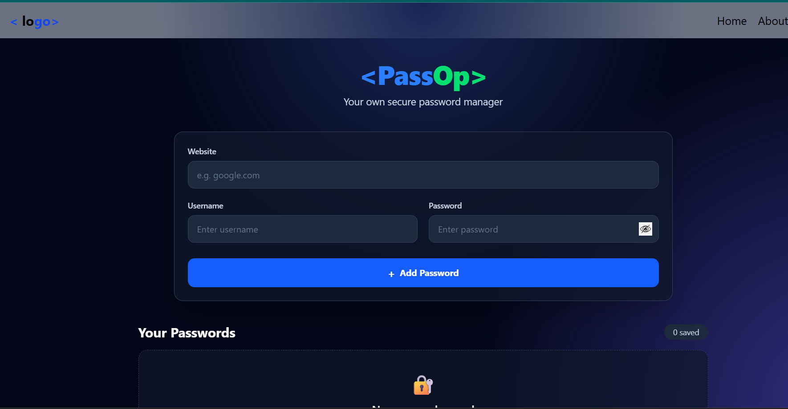

# PassOp &mdash; Personal Password Manager

> A lightweight, responsive credential management web application built with React and Tailwind CSS.

[](https://react.dev/)
[](https://vitejs.dev/)
[](https://tailwindcss.com/)
[](#license)

---

## 📖 Table of Contents

- [Project Overview](#-project-overview)
- [Key Features](#-key-features)
- [Tech Stack](#-tech-stack)
- [Screenshots](#-screenshots)
- [Project Architecture](#-project-architecture)
- [Project Structure](#-project-structure)
- [Getting Started](#-getting-started)
- [Environment Variables](#-environment-variables)
- [Running the Project](#-running-the-project)
- [API & Persistence Layer](#-api--persistence-layer)
- [Security Considerations](#-security-considerations)
- [What I Learned](#-what-i-learned)
- [Future Improvements](#-future-improvements)
- [Author](#-author)
- [Repository Link](#-repository-link)
- [License](#-license)

---

## 🌟 Project Overview

Remembering unique credentials for dozens of websites and digital services is a constant challenge. Many users resort to reusing vulnerable passwords across multiple accounts or jotting them down insecurely.

**PassOp** was built as a practical, hands-on portfolio project to explore core frontend engineering, component architecture, and client-side data persistence. It provides a clean, single-page dashboard where users can store website credentials, inspect them on demand with interactive visibility toggles, and delete them when no longer needed.

> **Note**: This application was created as an educational milestone in modern full-stack web development. It showcases reactive user interfaces and browser state management. Please review the [Security Considerations](#-security-considerations) section prior to saving sensitive production credentials.

---

## ✨ Key Features

The following capabilities are verified and implemented in the current codebase:

- **Credential Creation**: Save credentials with target Website/URL, Username, and Password fields.
- **Form Validation**: Client-side validation prevents submitting empty forms via browser alerts.
- **Browser Persistence**: Credentials persist across browser sessions using the browser's `localStorage` API.
- **Masked Password Display**: Stored passwords render masked (`••••••••`) by default in the credentials table.
- **Interactive Show/Hide Toggle**:
  - Independent visibility toggle on the password input field during entry.
  - Per-row visibility toggle on table records with custom eye iconography.
- **Saved Credentials Counter**: Dynamic badge displaying total number of stored entries.
- **Empty State UX**: Informative graphic and message (`No passwords saved`) when the credential vault is empty.
- **Entry Deletion**: Delete individual credentials by ID from both the state and `localStorage`.
- **Modern Responsive Design**: Built with Tailwind CSS v4 featuring radial gradient backdrops, frosted glass cards, and desktop/mobile friendly table layouts.

*(Features such as clipboard copying, editing existing entries, and live search filtering are planned for upcoming releases. See [Future Improvements](#-future-improvements).)*

---

## 🛠️ Tech Stack

### Frontend & Libraries

| Technology | Version | Purpose in Project |
| :--- | :--- | :--- |
| **React** | `^19.2.8` | Core UI library for declarative component design and state management (`useState`, `useEffect`). |
| **React DOM** | `^19.2.8` | Package that serves as the entry point to the DOM for React components. |
| **Vite** | `^8.3.0` | Next-generation frontend build tool providing fast Hot Module Replacement (HMR) and optimized bundling. |
| **Tailwind CSS** | `^4.3.3` | Utility-first CSS framework enabling dark-mode styling, glassmorphism, and responsive tables. |
| **@tailwindcss/vite**| `^4.3.3` | Vite plugin integrating Tailwind CSS v4 directly into the build pipeline. |
| **ESLint** | `^10.10.0` | Static code analysis tool enforcing clean JavaScript and React linting rules. |

### Data Storage

- **Web Storage API (`localStorage`)**: Browser-native key-value store used for client-side persistence of credential arrays formatted as JSON.

---


## 📸 Screenshots



---

## 🏗️ Project Architecture

Currently, the application runs entirely on the client side inside the user's web browser. State operations synchronize React component state with the browser's `localStorage`.

```mermaid
flowchart TD
    subgraph Browser ["Client-Side Browser Runtime"]
        User(["User Interaction"])

        subgraph ReactApp ["React 19 Application (Vite)"]
            Navbar["Navbar Component"]
            Manager["Manager Component (Core UI)"]
            State[("React State\n(passwordArray, form, showPassword)")]
        end

        subgraph WebStorage ["Browser Web Storage"]
            LocalStorage[("window.localStorage\nKey: 'password'")]
        end

        User -->|Enters Website, User, Pass| Manager
        Manager -->|Updates Form State| State
        Manager -->|On Submit| State
        State -->|Serializes JSON| LocalStorage
        LocalStorage -->|Mount (useEffect)| State
        State -->|Renders Table Rows| Manager
        Manager -->|Toggle / Delete Actions| State
    end
```

---

## 📂 Project Structure

The project follows a clean Vite + React directory layout:

```text
password-manager/
├── public/
│   ├── favicon.svg             # Application browser tab icon
│   ├── icons.svg               # SVG icons asset
│   └── logo/                   # Public logo directory (reserved for branding assets)
├── src/
│   ├── assets/
│   │   ├── eye.jpg             # Icon: password reveal (visible)
│   │   ├── eyeclose.png        # Icon: password conceal (hidden)
│   │   ├── hero.png            # Visual asset graphic
│   │   ├── react.svg           # React default asset
│   │   └── vite.svg            # Vite default asset
│   ├── components/
│   │   ├── Footer.jsx          # Footer component placeholder
│   │   ├── Manager.jsx         # Primary component (Form, Table, State & Storage logic)
│   │   └── Navbar.jsx          # Header navigation bar component
│   ├── App.css                 # Application-level styles
│   ├── App.jsx                 # Root component composing Navbar & Manager
│   ├── index.css               # Global stylesheet importing Tailwind CSS
│   └── main.jsx                # Application DOM entry point and React root mounting
├── .gitignore                  # Git ignore rules (node_modules, dist, etc.)
├── eslint.config.js            # ESLint configuration
├── index.html                  # HTML document template
├── package.json                # Project dependencies, metadata, and npm scripts
├── package-lock.json           # Locked dependency versions
├── vite.config.js              # Vite configuration with Tailwind CSS & React plugins
└── README.md                   # Project documentation
```

---

## 🚀 Getting Started

### Prerequisites

Ensure you have the following installed on your machine:

- **Node.js**: `v18.x` or higher (recommended LTS version)
- **npm**: `v9.x` or higher (comes bundled with Node.js)
- A modern web browser (Google Chrome, Mozilla Firefox, Microsoft Edge, Safari)

### Installation

1. **Clone the repository**:
   ```bash
   git clone https://github.com/your-username/password-manager.git
   ```

2. **Navigate into the project directory**:
   ```bash
   cd password-manager
   ```

3. **Install dependencies**:
   ```bash
   npm install
   ```

---

## 🔐 Environment Variables

The current release is entirely client-side and **does not require any environment variables** to run. All data persistence operations are handled through the browser's native `localStorage`.

If you extend this project with a dedicated backend server or third-party authentication services, maintain strict security hygiene:

```text
# Example .env configuration (for future backend or API integration)
VITE_API_BASE_URL=http://localhost:5000/api
```

> ⚠️ **Security Warning**: Never commit sensitive secrets, private encryption keys, database connection strings, or production credentials to source control. Always verify that `.env` and `.env.local` files are listed in `.gitignore`.

---

## 💻 Running the Project

All executable commands are configured in `package.json`:

### Start Development Server
Starts the local development server with Hot Module Replacement (HMR):
```bash
npm run dev
```
Open your browser and navigate to the local URL displayed in the terminal (typically `http://localhost:5173`).

### Build for Production
Compiles and bundles optimized static assets into the `dist/` directory:
```bash
npm run build
```

### Preview Production Build
Locally tests and previews the production build output:
```bash
npm run preview
```

### Run Linter
Checks source code against configured ESLint rules:
```bash
npm run lint
```

---

## 📡 API & Persistence Layer

### Current Implementation (Client-Side Storage)

The application currently has **no remote backend server or REST API**. Data operations are executed directly against the browser's storage engine:

| Operation | Storage Key | Method | Description |
| :--- | :--- | :--- | :--- |
| **Read** | `"password"` | `localStorage.getItem("password")` | Loads serialized JSON credential array into React state on component mount. |
| **Create** | `"password"` | `localStorage.setItem("password", ...)` | Appends a new credential object (`{ id, site, username, password }`) to the array. |
| **Delete** | `"password"` | `localStorage.setItem("password", ...)` | Writes an updated array excluding the credential matching the specified `id`. |

### Data Model

Each stored item follows this structure:

```json
{
  "id": 1728472500000,
  "site": "example.com",
  "username": "user@example.com",
  "password": "examplePassword123"
}
```

---

## 🔒 Security Considerations

As this project was developed as a practical frontend learning exercise, it is essential to be transparent regarding its security profile and limitations:

### Current Storage Method
- **Plaintext Storage**: Passwords saved through this app are currently serialized as raw strings and stored in `localStorage`.
- **No Encryption at Rest**: Passwords are **not** encrypted with AES, ChaCha20, or Web Crypto APIs prior to saving.

### Hashing vs. Encryption
It is important to understand the technical distinction between these cryptographic mechanisms:
- **Password Hashing** (e.g., bcrypt, Argon2) is a **one-way function**. It is used to verify a user's master login credentials without knowing the original text. You cannot decrypt a hash back into the original password.
- **Password Encryption** (e.g., AES-GCM-256) is a **two-way function**. It is required for a password vault so that the user's stored account passwords can be encrypted for safe storage and decrypted back into plaintext for display or copying, using a secret master key known only to the user.

### Known Limitations & Risks
1. **Cross-Site Scripting (XSS)**: Data stored in `localStorage` is accessible to any JavaScript running in the context of the same origin.
2. **Device / Browser Access**: Anyone with physical access to the browser or developer tools (`F12` > Storage > Local Storage) can inspect saved credentials.
3. **No Authentication**: The application does not require a master password, PIN, or biometric lock to view stored credentials.

### Safe-Use Recommendations
- 🚫 **Do not use this application to store real personal, banking, or sensitive passwords.**
- Use dummy or test credentials while evaluating or demonstrating this project.

---

## 🧠 What I Learned

Building this application provided practical hands-on experience in modern frontend development:

- **React 19 State Management**: Implementing `useState` to manage multiple form inputs, dynamic toggle states, and credential collections.
- **Side Effects with `useEffect`**: Correctly retrieving and synchronizing persistent client-side data on component initialization.
- **Tailwind CSS v4 Configuration**: Leveraging modern Tailwind v4 Vite plugin architecture, custom radial background styling, responsive layouts, and interactive UI states.
- **Component Decomposition**: Structuring UI cleanly across reusable components (`Navbar`, `Manager`, `Footer`).
- **Data Serialization**: Parsing and serializing complex objects to and from the browser's `localStorage` safely with JSON methods.
- **UX Details**: Designing practical user experience touches such as conditional empty states, dynamic counters, and password masking.

---

## 🔮 Future Improvements

Planned technical milestones for upcoming iterations include:

- [ ] **Client-Side Cryptography**: Integrate the Web Crypto API (`SubtleCrypto`) to encrypt credentials with AES-GCM using a user-derived master password before saving.
- [ ] **Full-Stack Backend Integration**: Build a dedicated Node.js / Express backend with an authenticated REST API.
- [ ] **Database Persistence**: Migrate from `localStorage` to a database (MongoDB / PostgreSQL) with protected collections per user.
- [ ] **Authentication & Authorization**: Implement user signup, login, JWT token authentication, and session handling.
- [ ] **Clipboard Copy Action**: Add a one-click copy button next to passwords with a toast confirmation notification.
- [ ] **Credential Editing**: Provide an update modal or in-line form to modify existing website and username entries.
- [ ] **Search & Filter**: Real-time search bar to filter stored credentials by website name or username.
- [ ] **Password Generator**: Integrated customizable generator for cryptographically strong, random passwords.

---

## 👤 Author

**Prakash Kumar**

- **Portfolio**: [https://prakash-kumar12.netlify.app/](https://prakash-kumar12.netlify.app/)
- **GitHub**: [https://github.com/prakash-kumar12](https://github.com/prakash-kumar12) *(Confirm your handle)*

---

## 🔗 Repository Link

- **Repository**: `[Repository URL Placeholder - https://github.com/prakash-kumar12/password-manager]`

---

## 📄 License

*This project is currently not distributed under a specific open-source license. All rights are reserved by the author unless otherwise stated.*
